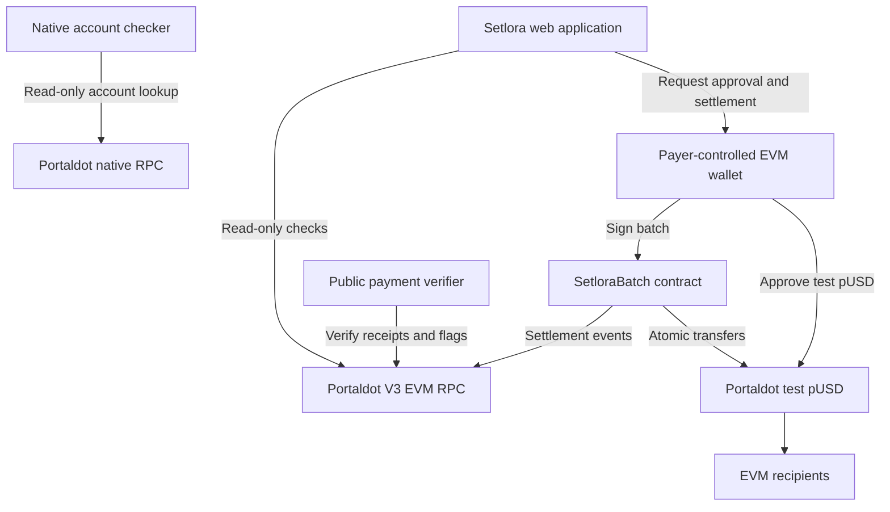

# Setlora

**Invoice-aware batch payments with verifiable receipts on Portaldot V3 Testnet.**

Setlora lets individuals, teams and organizations pay multiple EVM recipients—such as freelancers, suppliers, contractors and contributors—in one invoice-linked transaction instead of repeating wallet transfers and reconciling screenshots. The payer checks amounts and recipients, approves test pUSD when required, signs an atomic batch, and can independently verify settlement against public blockchain evidence.

Built for **Portaldot Hacker House 2026 — Ecosystem DApps**. The DoraHacks check-in was submitted. The latest reviewed wallet changes and acceptance report were pushed to GitHub on **November 5, 2026**; verification of the newly published Cloudflare build and final-submission materials remains to be completed. No final-review acceptance is claimed.

> **Experimental testnet software. No mainnet support or independent security audit. Do not use real funds.**

## How to test — Judges

- [Application](https://setlora.pages.dev/) · [Payment workspace](https://setlora.pages.dev/app) · [Wallet-free verifier](https://setlora.pages.dev/proof) · [Native account checker](https://setlora.pages.dev/native)
- [Documentation](https://setlora.pages.dev/docs/) · [Judge walkthrough](https://setlora.pages.dev/docs/how-to-test/) · [Source documentation](docs-site/src/content/docs/index.mdx)
- The public documentation was accessible in an earlier browser check. Recheck all routes after each new Cloudflare deployment; a successful local build does not itself prove that the current deployed version is live.

### Without a wallet

1. Explore the landing page and payment workflow.
2. Open the public verifier and enter the recorded settlement hash:
   `0x0ea4730fc73f3842a80f3015ee682ffa2bc0c5312fccf272d9899ee3ec1e3c16`.
3. Check the payer, three invoice events, batch total and settled flags. RPC failure means verification is unavailable, not that payment failed.
4. In the native account checker, select Invoice #1001 or #1003 and click **Check account** to inspect pUSD asset-account state and balance. This is read-only and cannot activate accounts or send native payouts.

### With your own EVM wallet

1. Select a supported injected EVM wallet and connect to **Portaldot V3 Testnet**, chain ID `420420777` (`0x190f1ca9`). If the selected wallet is on another chain, use the explicit **Switch to Portaldot V3** action; verify its actual network and reconnect before creating a fresh payment review. Network switching alone never approves a payment. If V3 is not installed, Setlora displays manual setup guidance rather than silently adding a network.
2. Use new invoice numbers, valid EVM recipients and small test pUSD amounts. Previously settled numbers cannot be reused by the same payer in this contract.
3. Review the batch and recipient checks. Changing accounts, networks or disconnecting invalidates previous readiness; recheck before authorizing. Reviewing does not sign or transfer funds.
4. Obtain test pUSD and gas tokens before payment. Test-token distribution is coordinated through Portaldot's official channels; no unrestricted public faucet is verified here.
5. Explicitly approve the token allowance if needed, then separately sign settlement. Verify the receipt before retrying any uncertain transaction.

Never share private keys or seed phrases.

## Product flow

**Prepare → Review → Authorize → Settle → Verify**

1. **Prepare:** enter or import up to 10 invoices with invoice numbers, EVM recipients and six-decimal pUSD amounts; save a browser-local draft.
2. **Review:** validate the input, active wallet/network, contract/token configuration, balances, settled flags and read-only recipient simulations.
3. **Authorize:** request an exact-total token approval if the existing allowance is insufficient. Approval alone does not pay recipients. An already sufficient allowance skips this approval request.
4. **Settle:** estimate the full batch and request an explicit settlement signature. The fixed-token contract calls `transferFrom` for each invoice; all transfers succeed together or revert together.
5. **Verify:** reconcile the receipt, matching invoice events, batch total and on-chain flags before enabling a verified JSON receipt. Recover previous payments by transaction hash.

## Implemented functionality

- Responsive landing page, payment workspace, EIP-6963 wallet discovery, account switching and explicit selected-wallet network switching with fresh account/chain checks.
- Invoice validation, CSV import and a maximum of 10 invoices per batch.
- Wallet/network checks, contract bytecode presence, token identity and six-decimal checks.
- Recipient simulations, full-batch gas estimation, explicit approval and settlement signatures.
- Atomic pUSD transfers, payer-scoped invoice replay prevention and a reentrancy guard.
- Public wallet-free verification and payer-scoped recovery in the payment workspace.
- Conservative pending/unknown handling, verified receipt export, saved drafts and browser-local payment history.
- Read-only native account checker and MDX documentation with a combined site build.

## Latest acceptance evidence — November 5, 2026

The release candidate was tested locally and the results were recorded in the [final acceptance report](docs/FINAL-ACCEPTANCE-REPORT.md). These results distinguish **real MetaMask user observations** from **automated tests against synthetic wallet providers**; they are not a security audit or production-byte certification.

| Acceptance check | Result | Scope |
| --- | --- | --- |
| Frontend unit tests | **121 passed** | Local automated test suite |
| Browser assertions | **125 passed** | Synthetic wallet/RPC and isolated transaction-boundary cases |
| Solidity contract tests | **9 passed** | Foundry mock-token tests; no contract changes |
| Documentation and combined production build | **Passed** | All nine required combined HTML routes generated locally |
| Responsive browser checks | **Passed** | Emulated widths of 390, 768 and 1440 pixels |
| Real MetaMask connection and network switching | **Passed in tested path** | User-observed switch from Base Sepolia to Portaldot V3 (`0x190f1ca9`), followed by reconnect |
| Account change and payment review invalidation | **Passed in tested path** | Old account readiness disabled; new account required a fresh review |
| Disconnect, refresh and draft restoration | **Passed in tested path** | Invoice `2002`, `0.05 pUSD`, restored for the previously connected account |
| Public RPC DNS and chain-ID response | **Passed at test time** | Does not guarantee continuous endpoint availability |

The final manual tests did **not** approve tokens, sign settlement or broadcast new payments. Rejection, pending wallet requests, rapidly changing networks, additional wallet extensions and broader accessibility scenarios are not fully covered by this manual run. The historical paid batch below remains the actual on-chain settlement evidence.

## Verified testnet deployment and settlement

The following is recorded Portaldot V3 testnet evidence, including the three-recipient batch checked on **October 31, 2026**. It is not an independent audit or a claim of mainnet readiness.

| Deployment field | Recorded value |
| --- | --- |
| Network | Portaldot V3 Testnet |
| Chain ID | `420420777` |
| Contract | `0x2d17199920251f7eec8a555043c8387194ff5d1b` |
| Deployment transaction | `0x34ddf0af59d82b991fdb07a72679c8e1f52e0aa0f8e9aa15d260278fb1092b24` |
| Deployment block | `255194` |
| pUSD token | `0x00001E6100000000000000000000000000010000` |
| Token decimals | `6` |
| Payer | `0x9Ceaa6aBFb2bC1aC202f96496Cdc683d86Bc458a` |

**Settlement transaction:** `0x0ea4730fc73f3842a80f3015ee682ffa2bc0c5312fccf272d9899ee3ec1e3c16`

| Invoice | Amount | Recorded result |
| --- | ---: | --- |
| `1001` | 0.10 pUSD | Settled |
| `1002` | 0.15 pUSD | Settled |
| `1003` | 0.20 pUSD | Settled |
| **Total** | **0.45 pUSD** | **One transaction, three recipients** |

Recorded checks covered the successful receipt, three `InvoiceSettled` events, the `BatchSettled` total and `isSettled` flags. Subsequent read-only queries showed 0.10, 0.15 and 0.20 pUSD in the corresponding recipient accounts. These are prior testnet observations, not newly executed transfers in this documentation review. The [contract source](contracts/src/SetloraBatch.sol) and [settlement specification](docs/SETTLEMENT-SPEC.md) describe the implementation; no explorer source-verification claim is made.

## Architecture



The browser application uses EVM RPC reads and a payer-controlled wallet for signatures. `SetloraBatch` has an immutable token, no administrator and no custody account. Token transfers go directly from the payer to recipients using allowance. The public verifier reads chain evidence without a wallet. The native account checker reads the native RPC; it is separate from EVM settlement. Drafts and payment history live in browser storage.

## Release status and final submission work

The **DoraHacks check-in was submitted** and the four reviewed wallet/release commits up through `31f0919` were pushed to GitHub `main` on November 5, 2026. The fixed-token contract is already deployed; the recorded 0.45 pUSD settlement demonstrates real Portaldot V3 EVM activity. This does not mean the final judging submission has been accepted.

The remaining release gates are to confirm GitHub Actions passes on the latest commit; verify Cloudflare Pages actually serves that version, including `/docs/`, `/app`, `/proof` and `/native`; recheck the historical settlement in the live verifier; and finalize a public **under-three-minute** demo video, pitch deck and DoraHacks final-submission details. A previous deployment check cannot certify new published bytes.

The current supported core product is **EVM-to-EVM invoice-linked pUSD batch payments**. Native SS58 payouts, sponsored onboarding and cross-chain settlement are future work and should not be represented as shipped features. Independent security review and broader wallet/accessibility testing remain necessary for use beyond this limited testnet demonstration.

### Hackathon materials

- [Check-in demonstration video](https://youtu.be/w2XcGtL8P_s) — historical submission material; review or replace it for the final deliverable.
- [Working pitch deck](https://docs.google.com/presentation/d/1jRV6nafkZbGGEB4qXH48YT2Ytf6yBb7UOgc_XoiaBPo/edit?usp=sharing) — confirm public access and final content before submission.
- [Final acceptance report](docs/FINAL-ACCEPTANCE-REPORT.md) · [Settlement specification](docs/SETTLEMENT-SPEC.md) · [Threat model](docs/THREAT-MODEL.md).

## Limitations and safety boundaries

- Native SS58 payouts, sponsored onboarding and cross-chain settlement are **not implemented**. The native account checker is read-only; the payment form accepts EVM `0x...` recipients only.
- No mainnet support and no independent security audit. The nine named Foundry tests are bounded local checks, not exhaustive security verification.
- Invoice uniqueness is scoped to a payer within this contract. There is no invoice-issuer authentication or organizational approval workflow; another ID or wallet can pay the same real obligation again.
- Recipient simulations are preflight checks, not guarantees. Token/account state can change before inclusion. Atomicity covers one EVM settlement, not cross-chain execution.
- The contract assumes a standard bool-returning, full-amount `transferFrom`. Fee-on-transfer and nonstandard tokens are not supported.
- An RPC timeout does not prove failure. Do not resend blindly; recover using transaction evidence and invoice flags. A flag alone does not prove a specific recipient or amount.
- Addresses, invoice numbers, amounts and events are public. Drafts and history are browser-local, can be lost or altered, and **do not synchronize automatically across devices**. Recheck saved receipts against the chain.

See the [native account research roadmap](docs/NATIVE-ACCOUNTS-ROADMAP.md) for future native support; it is not a shipped payout feature.

## Local installation and validation

Requirements: **Node.js 22.23.4+ (or a supported Node.js 24 release)**, npm and **Foundry**. Run each block from the repository root. No private key is needed for local tests.

```sh
cd web
npm ci
npm test
npm run build
```

For the configured local app, create `web/.env.local` with this public address:

```dotenv
VITE_SETLORA_CONTRACT_ADDRESS=0x2d17199920251f7eec8a555043c8387194ff5d1b
```

Run `npm run dev -- --port 5173 --strictPort` from `web/`. Open `http://127.0.0.1:5173/` or `/app.html`, `/proof.html`, `/native.html`. Without a configured contract the payment workspace stays in preview mode. A public contract address is not a secret; never put private signing material in environment files or the repository.

```sh
cd docs-site
npm ci
npm run check:content
npm run build
# Optional local documentation preview at http://127.0.0.1:4321/docs/
npm run dev
```

```sh
cd web
npm run build:site
```

The combined build emits the existing application pages (`index.html`, `app.html`, `proof.html`, `native.html`) and documentation under `web/dist/docs/`. The standalone documentation output is `docs-site/dist/`. The documentation was observed on the public site previously; recheck its latest deployed version after the release. Preserve the public contract environment setting when building a configured app.

```sh
cd contracts
forge test -vv
forge build
```

## Repository structure

| Path | Purpose |
| --- | --- |
| `web/` | Vite application, landing page, public verifier, native checker and frontend tests |
| `web/scripts/bundle-docs.mjs` | Copies documentation into the combined application output |
| `docs-site/` | Astro/Starlight MDX guides and content-link checks |
| `contracts/src/SetloraBatch.sol` | Fixed-token atomic settlement contract |
| `contracts/test/SetloraBatch.t.sol` | Nine named local Foundry tests |
| `docs/` | Current status, settlement spec, threat model, research and historical milestone reports |
| `.github/workflows/ci.yml` | Frontend, documentation/combined-site and Foundry CI checks |

Please keep private keys, seed phrases and personal payment records out of public issues.
