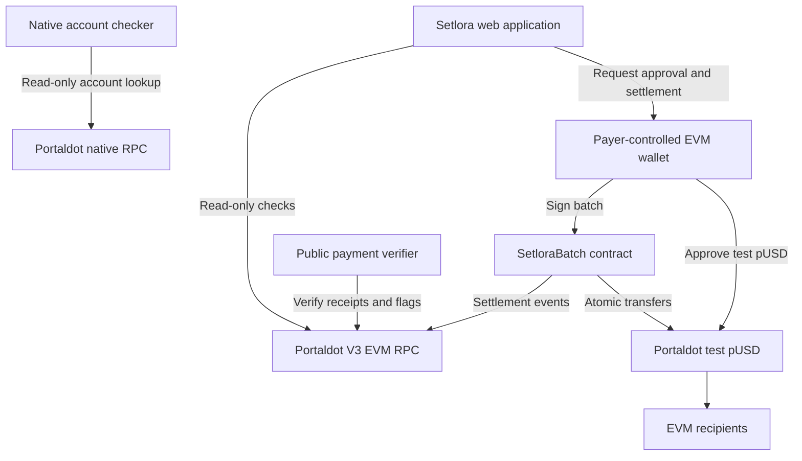

# Setlora

**Invoice-aware batch payments with verifiable receipts on Portaldot V3 Testnet.**

Setlora helps teams pay contributors without juggling separate transfers, spreadsheets and screenshots. A payer attaches invoice numbers to payments, reviews the batch and signs one atomic settlement to several EVM recipients. Public chain evidence supports checking the result independently of the payer's browser.

Built for **Portaldot Hacker House 2026 — Ecosystem DApps**. The check-in has been **submitted and is under review**. Final-release preparation is ongoing.

> **Experimental testnet software. No mainnet support or independent security audit. Do not use real funds.**

## How to test — Judges

- [Application](https://setlora.pages.dev/) · [Payment workspace](https://setlora.pages.dev/app) · [Wallet-free verifier](https://setlora.pages.dev/proof) · [Native account checker](https://setlora.pages.dev/native)
- Documentation is intended for **`/docs/`**. Its public deployment has not been verified in this release review; use the [documentation source](docs-site/src/content/docs/index.mdx) or local preview below.

### Without a wallet

1. Explore the landing page and payment workflow.
2. Open the public verifier and enter the recorded settlement hash:
   `0x0ea4730fc73f3842a80f3015ee682ffa2bc0c5312fccf272d9899ee3ec1e3c16`.
3. Check the payer, three invoice events, batch total and settled flags. RPC failure means verification is unavailable, not that payment failed.
4. In the native account checker, select Invoice #1001 or #1003 and click **Check account** to inspect pUSD asset-account state and balance. This is read-only and cannot activate accounts or send native payouts.

### With your own EVM wallet

1. Connect a supported browser wallet on Portaldot V3 Testnet, chain ID `420420777`.
2. Use new invoice numbers, valid EVM recipients and small test pUSD amounts. Previously settled numbers cannot be reused by the same payer in this contract.
3. Review the batch and recipient checks. Reviewing does not sign or transfer funds.
4. Obtain test pUSD and gas tokens before payment. Test-token distribution is coordinated through Portaldot's official channels; no unrestricted public faucet is verified here.
5. Explicitly approve the token allowance if needed, then separately sign settlement. Verify the receipt before retrying any uncertain transaction.

Never share private keys or seed phrases.

## Product flow

**Prepare → Review → Authorize → Settle → Verify**

1. **Prepare:** enter or import up to 10 invoices with invoice numbers, EVM recipients and six-decimal pUSD amounts; save a browser-local draft.
2. **Review:** validate the input, active wallet/network, contract/token configuration, balances, settled flags and read-only recipient simulations.
3. **Authorize:** request an exact-total token approval if the existing allowance is insufficient. Approval alone does not pay recipients. An already sufficient allowance skips this approval request.
4. **Settle:** estimate the full batch and request an explicit settlement signature. The fixed-token contract calls `transferFrom` for each invoice; all transfers succeed together or revert together.
5. **Verify:** reconcile the receipt, matching invoice events, batch total and on-chain flags before enabling a verified JSON receipt. Recover previous payments by transaction hash.

## Implemented functionality

- Responsive landing page, payment workspace, EVM wallet discovery and account switching.
- Invoice validation, CSV import and a maximum of 10 invoices per batch.
- Wallet/network checks, contract bytecode presence, token identity and six-decimal checks.
- Recipient simulations, full-batch gas estimation, explicit approval and settlement signatures.
- Atomic pUSD transfers, payer-scoped invoice replay prevention and a reentrancy guard.
- Public wallet-free verification and payer-scoped recovery in the payment workspace.
- Conservative pending/unknown handling, verified receipt export, saved drafts and browser-local payment history.
- Read-only native account checker and MDX documentation with a combined site build.

## Verified testnet deployment and settlement

The following is recorded Portaldot V3 testnet evidence, including the three-recipient batch checked on **October 31, 2026**. It is not an independent audit or a claim of mainnet readiness.

| Deployment field | Recorded value |
| --- | --- |
| Network | Portaldot V3 Testnet |
| Chain ID | `420420777` |
| Contract | `0x2d17199920251f7eec8a555043c8387194ff5d1b` |
| Deployment transaction | `0x34ddf0af59d82b991fdb07a72679c8e1f52e0aa0f8e9aa15d260278fb1092b24` |
| Deployment block | `255194` |
| pUSD token | `0x00001E6100000000000000000000000000010000` |
| Token decimals | `6` |
| Payer | `0x9Ceaa6aBFb2bC1aC202f96496Cdc683d86Bc458a` |

**Settlement transaction:** `0x0ea4730fc73f3842a80f3015ee682ffa2bc0c5312fccf272d9899ee3ec1e3c16`

| Invoice | Amount | Recorded result |
| --- | ---: | --- |
| `1001` | 0.10 pUSD | Settled |
| `1002` | 0.15 pUSD | Settled |
| `1003` | 0.20 pUSD | Settled |
| **Total** | **0.45 pUSD** | **One transaction, three recipients** |

Recorded checks covered the successful receipt, three `InvoiceSettled` events, the `BatchSettled` total and `isSettled` flags. Subsequent read-only queries showed 0.10, 0.15 and 0.20 pUSD in the corresponding recipient accounts. These are prior testnet observations, not newly executed transfers in this documentation review. The [contract source](contracts/src/SetloraBatch.sol) and [settlement specification](docs/SETTLEMENT-SPEC.md) describe the implementation; no explorer source-verification claim is made.

## Architecture



The browser application uses EVM RPC reads and a payer-controlled wallet for signatures. `SetloraBatch` has an immutable token, no administrator and no custody account. Token transfers go directly from the payer to recipients using allowance. The public verifier reads chain evidence without a wallet. The native account checker reads the native RPC; it is separate from EVM settlement. Drafts and payment history live in browser storage.

## Status and remaining final-release work

The November 2 check-in recorded the implemented payment flow, public verifier, native checker and settlement evidence above. **The check-in is now submitted and under review.** Deployment and pUSD payment integration are implemented and have recorded testnet evidence.

Remaining final-release work:

- Complete a final live-site walkthrough, including application routes and the intended `/docs/` route after publication is verified.
- Extend wallet and recipient edge-case testing, including pending/unknown recovery and browser/mobile/accessibility checks on the live site.
- Finish the final submission video, pitch materials and final demonstration.
- Complete further security review and the testing described in the [threat model](docs/THREAT-MODEL.md) before considering any mainnet work.

## Limitations and safety boundaries

- Native SS58 payouts, sponsored onboarding and cross-chain settlement are **not implemented**. The native account checker is read-only; the payment form accepts EVM `0x...` recipients only.
- No mainnet support and no independent security audit. The nine named Foundry tests are bounded local checks, not exhaustive security verification.
- Invoice uniqueness is scoped to a payer within this contract. There is no invoice-issuer authentication or organizational approval workflow; another ID or wallet can pay the same real obligation again.
- Recipient simulations are preflight checks, not guarantees. Token/account state can change before inclusion. Atomicity covers one EVM settlement, not cross-chain execution.
- The contract assumes a standard bool-returning, full-amount `transferFrom`. Fee-on-transfer and nonstandard tokens are not supported.
- An RPC timeout does not prove failure. Do not resend blindly; recover using transaction evidence and invoice flags. A flag alone does not prove a specific recipient or amount.
- Addresses, invoice numbers, amounts and events are public. Drafts and history are browser-local, can be lost or altered, and **do not synchronize automatically across devices**. Recheck saved receipts against the chain.

See the [native account research roadmap](docs/NATIVE-ACCOUNTS-ROADMAP.md) for future native support; it is not a shipped payout feature.

## Local installation and validation

Requirements: **Node.js 22+**, npm and **Foundry**. Run each block from the repository root. No private key is needed for local tests.

```sh
cd web
npm ci
npm test
npm run build
```

For the configured local app, create `web/.env.local` with this public address:

```dotenv
VITE_SETLORA_CONTRACT_ADDRESS=0x2d17199920251f7eec8a555043c8387194ff5d1b
```

Run `npm run dev -- --port 5173 --strictPort` from `web/`. Open `http://127.0.0.1:5173/` or `/app.html`, `/proof.html`, `/native.html`. Without a configured contract the payment workspace stays in preview mode. A public contract address is not a secret; never put private signing material in environment files or the repository.

```sh
cd docs-site
npm ci
npm run check:content
npm run build
# Optional local documentation preview at http://127.0.0.1:4321/docs/
npm run dev
```

```sh
cd web
npm run build:site
```

The combined build emits the existing application pages (`index.html`, `app.html`, `proof.html`, `native.html`) and documentation under `web/dist/docs/`. The standalone documentation output is `docs-site/dist/`. Build success does not establish that `/docs/` is publicly deployed. Preserve the public contract environment setting when building a configured app.

```sh
cd contracts
forge test -vv
forge build
```

## Repository structure

| Path | Purpose |
| --- | --- |
| `web/` | Vite application, landing page, public verifier, native checker and frontend tests |
| `web/scripts/bundle-docs.mjs` | Copies documentation into the combined application output |
| `docs-site/` | Astro/Starlight MDX guides and content-link checks |
| `contracts/src/SetloraBatch.sol` | Fixed-token atomic settlement contract |
| `contracts/test/SetloraBatch.t.sol` | Nine named local Foundry tests |
| `docs/` | Current status, settlement spec, threat model, research and historical milestone reports |
| `.github/workflows/ci.yml` | Frontend and contract CI checks |

Please keep private keys, seed phrases and personal payment records out of public issues.
